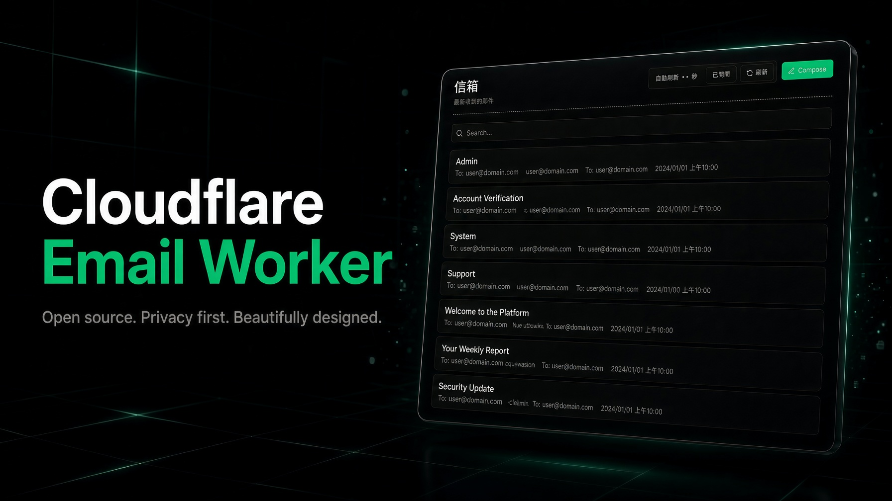

# Cloudflare Email Worker

[中文](docs/README_zh.md)



Receives mail through Cloudflare Email Routing and serves webmail from a Worker. D1 stores message data. R2 stores attachments and larger raw messages.

## Try it

Open [https://demo.emailwk.itdog.ai](https://demo.emailwk.itdog.ai). 
That host lists mail for `demo@emailwk.itdog.ai`. (not catch-all)

## Features

- Inbox paging, search by subject, sender, or recipient, and automatic refresh.
- HTML and plain-text bodies, remote and CID inline images, raw source, full headers, and attachment downloads.
- Admin hosts can send plain-text mail with CC, BCC, and attachments. A successful send is stored in `sent`. A failed send is written to the inbox as a notice.
- Accepts messages that include a one-click unsubscribe header.
- Optional member login on admin hosts, with separate receive/send domain permissions, password initialization, member management, and sent-mail browsing.

## First-time setup

Requires Node.js 22.18 or newer, and Email Routing enabled on the Cloudflare zone.

Sending from the Worker requires a Workers Paid plan. After that, set the sending domain in the Cloudflare dashboard so the Worker can send directly.

```bash
git clone https://github.com/siumx/cf-email-worker.git
cp package.json.example package.json
cp wrangler.toml.example wrangler.toml
npx wrangler login
npm run init
npm run deploy
```

- `wrangler.toml`: set the site hostnames. Before `npm run init`, check that this Cloudflare account does not already have a D1 named `email-worker-db` or an R2 bucket named `email-worker`. 
- `ADMIN_MAIL_HOSTS`: full hostnames that can read every inbox and send mail. Any other host drops its first label and only shows mail for the remaining recipient domain. `mail.example.com` therefore matches `*@example.com`.
- `SENDABLE_DOMAINS`: sender domains this Worker may use. Sending is disabled when the value is unset or an empty array.
- `RECEIVABLE_DOMAINS`: domains that an admin may assign to members for reading mail. This does not change Email Routing ingestion or other hosts' catch-all views.

After deploy, point the destination addresses or the catch-all in Cloudflare Email Routing at this Worker. Walkthrough: [Cloudflare Email Routing Setup](docs/Cloudflare_Email_Routing_Setup.md).

## Optional members

Member mode applies **only to `ADMIN_MAIL_HOSTS`**. Other route hosts retain their existing catch-all view and cannot send, even with an admin session. They can still display all recipients in their matching domain, including member addresses. Without member mode, continue protecting admin hosts with Cloudflare Access.

Keep `compatibility_flags = ["nodejs_compat"]` in your Wrangler config. To upgrade an existing database, apply the migration once using the config for that deployment; do not rerun the initial schema:

```bash
npm install
npm run db:migrate:remote -- -c wrangler.toml
npm run member:setup -- .dev.vars
npx wrangler secret bulk .dev.vars -c wrangler.toml
```

The setup command prompts for a hidden admin password of 12–128 characters and saves a password hash, a random pepper, and a separate JWT key in `.dev.vars` with owner-only permissions. It preserves an existing pepper and JWT key when changing the admin password. Local secret files are ignored by Git. Use a separate file for each deployment, and do not change an existing pepper unless you intend to reset all member passwords.

Enable member mode and choose the available domains:

```toml
[vars]
ADMIN_MAIL_HOSTS = ["mailadmin.example.com"]
MEMBER = { enable = true, admin = "admin" }
RECEIVABLE_DOMAINS = ["example.com", "abc.com"]
SENDABLE_DOMAINS = ["example.com", "notify.example.com"]
```

Then deploy using your normal command. Missing `MEMBER`, `enable = false`, or no `admin` keeps legacy mode. When enabled, missing or malformed secrets return a configuration error instead of allowing anonymous admin access.

The admin is configured outside the member table and can read all stored mail, send from every configured sender domain, and create, disable, delete, reset passwords, or change member domain permissions. Sign in to create the first member. The member's fixed, case-insensitive account prefix is also their mailbox prefix. For example, `user` with receive domains `example.com` and `abc.com` reads exactly `user@example.com` and `user@abc.com`. Send permissions are independent. Global domain removals take effect on the next request.

New members and members whose passwords are reset must change their initial password before reading or sending. Passwords use scrypt (`N=16384, r=8, p=5`), a random salt, then HMAC-SHA256 with a pepper held in a Worker Secret. One-hour HS256 JWTs use host-only, Secure, HttpOnly, SameSite cookies and are not stored server-side. Disabling, deleting, and password changes reject existing tokens on the next request. Logout only clears the browser cookie; a copied token stays valid until it expires. Admin credential or pepper changes reject existing admin tokens. Native password hashing requires adequate Worker CPU budget; verify it under your deployed plan.

Deleting a member retains their mail and reserves the prefix to prevent another account inheriting old mail. Existing inbound mail is matched by recipient; old sent copies without an owner remain admin-only. New sent copies and failure notices are tied to the sending member, including for send-only domains.

For local development, apply `src/SQL/schema.sql` to a new local database, run `npm run db:migrate:local -- -c wrangler.toml`, then `npx wrangler dev`. Do not apply the initial schema to an existing database.

Run `npm run typecheck` and `npm test` for type and authorization checks. `npm run test:workers` also verifies native crypto, migrations and JWTs in an isolated local Workers runtime; it requires permission to bind localhost ports.

## Layout

- `src/`: Worker. `index.ts` routes requests, `handlers.ts` handles mail, `db.ts` talks to D1, `SQL/schema.sql` is the schema applied by `npm run init`.
- `public/`: webmail UI, served as Worker assets.
- `migrations/`: D1 upgrades for existing installations. `scripts/member-admin.mjs` initializes or updates admin secrets.
- `wrangler.toml.example`: config template. Copy it to `wrangler.toml`.

## API

Routes are in `src/index.ts`. Callers must handle `400`, `401`, `403`, `404`, `405`, `409`, and `503`. Member APIs are unavailable outside enabled admin hosts. Writes require a matching `Origin` and `X-Requested-With: cf-email-worker`; browser sessions use the same-origin cookie. Private API responses are not cached.

| Method | Path | Purpose |
| --- | --- | --- |
| `GET` | `/api/config` | Host mode, login state, identity and allowed sender domains; public bootstrap |
| `GET` | `/api/mails?page=&q=&folder=inbox` | Scoped list; member mode also supports `folder=sent` |
| `GET` | `/api/mails/:id` | One message |
| `GET` | `/api/mails/:id/attachments/:attachmentId` | Attachment download |
| `POST` | `/api/mails/:id/unsubscribe` | One-click unsubscribe |
| `POST` | `/api/send` | Send mail. Admin hosts only |
| `POST` | `/api/auth/login` | `{prefix, password}` → identity and session cookie |
| `POST` | `/api/auth/logout` | Clear the session cookie; the token stays valid until it expires |
| `GET` | `/api/auth/me` | Current identity, including the initial-password flag |
| `POST` | `/api/auth/password` | User only: `{currentPassword, password}`; reject old tokens and issue a new one |
| `GET` | `/api/members?page=&q=` | Admin only: paged members, counts and domain choices |
| `POST` | `/api/members` | Admin only: `{prefix, password?, receiveDomains, sendDomains}` → ID and one-time initial password |
| `PATCH` | `/api/members/:id` | Admin only: `{status?}` and/or both domain arrays; prefix is immutable |
| `DELETE` | `/api/members/:id` | Admin only: revoke access and reserve the prefix |
| `POST` | `/api/members/:id/password` | Admin only: `{password?}` → one-time initial password and reject existing tokens |

## Limits

- Member isolation applies only to enabled admin hosts. Other hosts keep their existing catch-all access. Use Cloudflare Access for any hosts that should not be publicly readable.
- Message HTML is shown in a sandboxed iframe. Layout and images stay; scripts and event handlers are removed. Remote images load directly, so the sender can tell that the message was opened.
