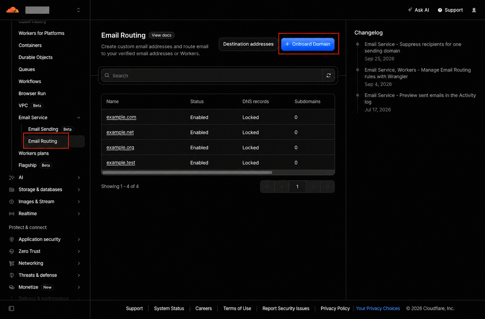
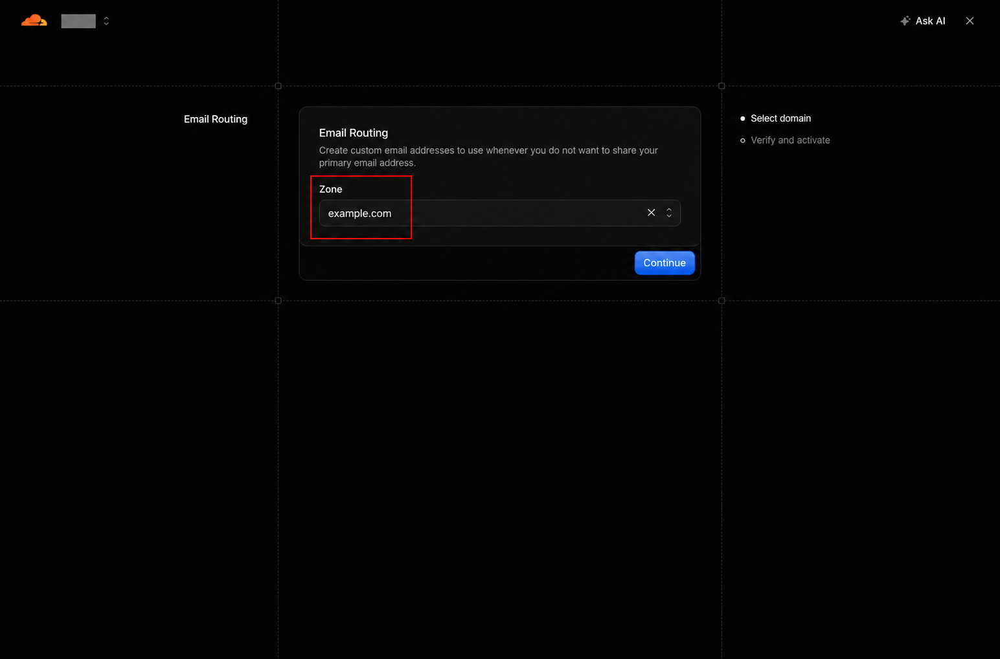
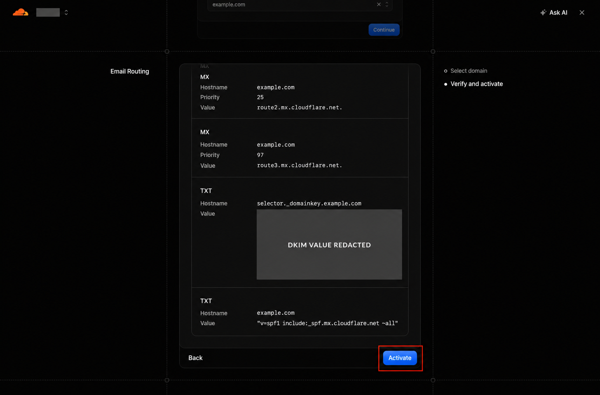
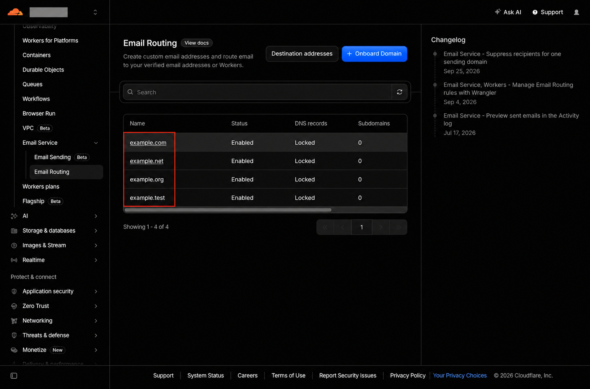
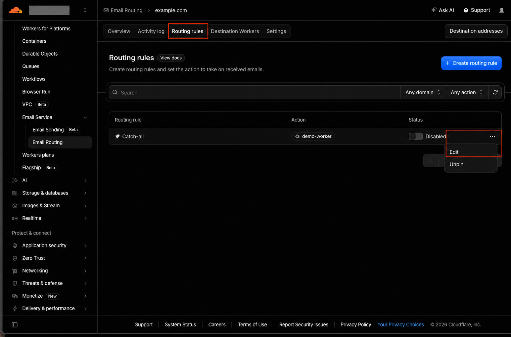
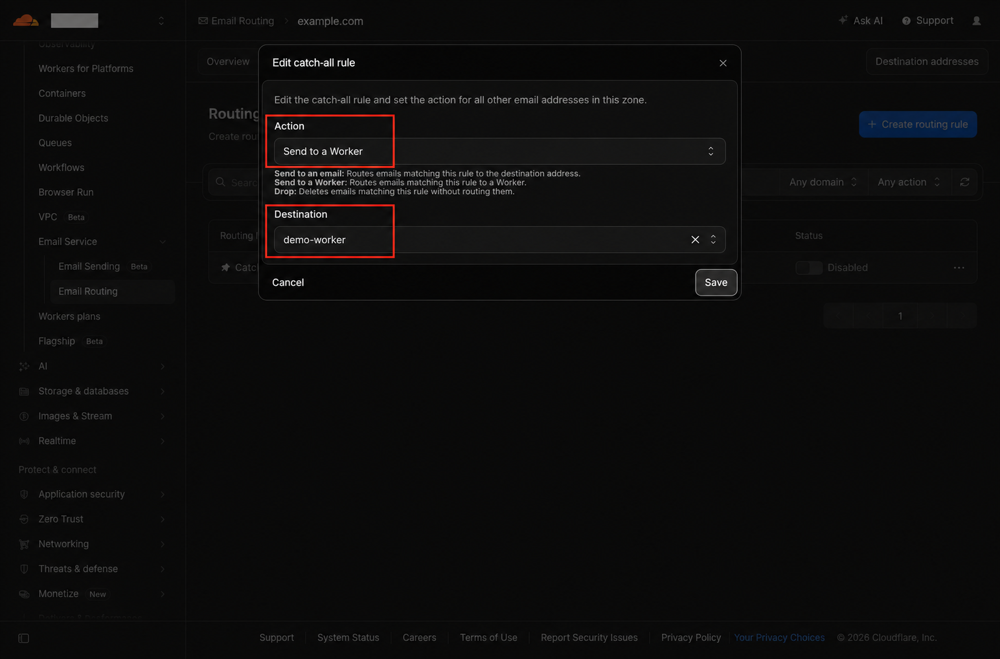
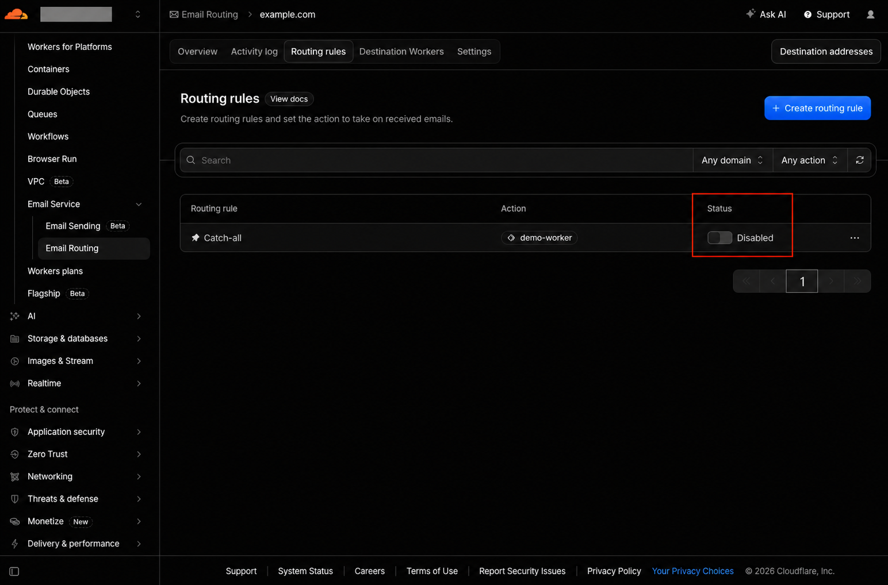

# Cloudflare Email Routing Setup

*Route catch all email to a Cloudflare Worker*

Enable Email Routing for your domain, send messages that do not match a specific address rule to a Worker, and verify delivery. Use your own domain and deployed Worker wherever example.com and demo-worker appear.

## Before you begin

Have a domain using Cloudflare DNS, access to its Email Routing and DNS settings, and a deployed Worker with an email handler. If the Worker forwards mail, add the receiving mailbox under Destination addresses and verify it using Cloudflare's email. [^1][^3]

**Existing mail service:** Changing MX records changes where incoming mail is delivered. Plan the change with the current mail provider before activating Email Routing. [^2]

## Step 1 Open Email Routing

Sign in to the Cloudflare dashboard and select the correct account. Go to Compute > Email Service > Email Routing, then click Onboard Domain. [^1]

*Figure 1  Open Email Routing and start domain onboarding*

## Step 2 Select your domain

Choose your domain in the Zone dropdown, then click Continue.

*Figure 2  Select the domain to configure*

## Step 3 Review DNS records and activate

Review the MX and TXT records shown by Cloudflare. MX records direct incoming mail to Cloudflare; the TXT records configure SPF and DKIM. Scroll through the full list, then click Activate. [^2]

Use the values generated for your own domain. The screenshot shows part of the record list. Resolve any record conflicts first; keep one SPF record with the required authorizations. [^2]

*Figure 3  Review the proposed records and click Activate*

**Expected result:** Domain onboarding completes. DNS changes may take time to propagate; wait and recheck the domain status if activation is still pending. [^1]

Some dashboard versions finish onboarding with Done. Complete the confirmation shown in your dashboard. [^1]

## Step 4 Open the configured domain

Return to the Email Routing domain list. Find the domain you just configured, confirm that its Status is Enabled, and click its name. A Locked DNS records label means Cloudflare is managing those records. [^2]

*Figure 4  Open the domain whose routing settings you want to change*

## Step 5 Edit the catch all rule

Open the Routing rules tab. In the Catch-all row, click the three-dot menu on the right and select Edit.

*Figure 5  Open Routing rules and edit Catch-all*

The catch-all rule handles email addresses in this domain that are not handled by a more specific rule. It can also receive messages sent to misspelled or unexpected addresses. [^3]

## Step 6 Choose the destination Worker

In Edit catch-all rule, set Action to Send to a Worker. In Destination, select your deployed email Worker, then click Save. The example Worker is named demo-worker.

*Figure 6  Choose Send to a Worker and save the destination*

### Confirm the Worker is ready

The Worker must contain an email handler that performs the processing you need. Selecting a destination connects the rule to that Worker; the Worker code determines whether the message is forwarded, rejected, or otherwise processed. [^1][^3]

- Confirm that the selected Worker is deployed in the correct account and appears in the Destination dropdown.
- If forwarding is intended, confirm the receiving mailbox is a verified destination address in Cloudflare and that the Worker uses that address. [^1][^3]

If the Worker is missing from the list, check its deployment and email handler before proceeding.

### For direct forwarding to a mailbox

If you do not need Worker processing, choose Send to an email instead and select a verified destination address. Click Save, then enable the catch-all rule as described in Step 7. [^3]

## Step 7 Enable the catch all rule

Back on Routing rules, turn on the Status toggle for Catch-all. Confirm that it shows Active or the equivalent enabled state. Saving the destination and enabling the rule are separate checks. [^3]

*Figure 7  The switch is still OFF here  Turn it on to activate the rule*

**The screenshot shows Disabled,** which is the state before this step is complete. The domain can be Enabled while the catch-all rule is still Disabled.

## Step 8 Test incoming mail

Send a test message from an external email account to a new address at your domain, such as routing-test@example.com. Choose an address with no separate routing rule so the test exercises Catch-all. [^1][^3]

Check the Worker execution logs or your application's expected result. If the Worker forwards messages, confirm receipt in the destination inbox and check spam if needed. Use a sender different from the forwarding destination. [^1]

**Setup is complete** when the domain is enabled, the catch-all rule is active, the intended Worker is selected, and a test message produces the expected result.

### If the test fails

No incoming message: Recheck the domain's MX records, DNS propagation and catch-all status. Worker runs but no delivery: Inspect its logs and forwarding logic, verify the destination mailbox, and check spam. Wrong rule runs: Use a test address without a specific address rule.

## Official Cloudflare references

[^1]: [Route emails](https://developers.cloudflare.com/email-service/get-started/route-emails/)

[^2]: [Domain configuration](https://developers.cloudflare.com/email-service/configuration/domains/)

[^3]: [Email routing rules and addresses](https://developers.cloudflare.com/email-service/configuration/email-routing-addresses/)
