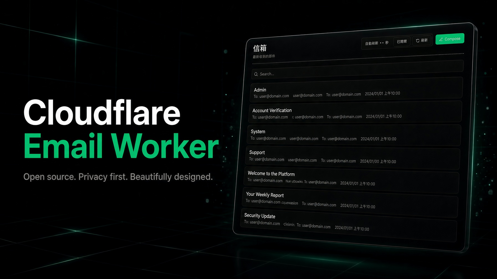

# Cloudflare Email Worker

[English](../README.md)



以 Cloudflare Email Routing 收信，Workers 提供 Webmail。D1 儲存郵件資料，R2 儲存附件與較大的原始郵件。

## 功能

- 收件匣分頁、搜尋主旨／寄件者／收件者，以及自動重新整理。
- HTML／純文字內容、外部與 CID 內嵌圖片、Raw 原文、完整標頭與附件下載。
- 管理網域可寄送純文字郵件、CC／BCC 與附件。成功寄件備份至 `sent`，失敗寫入收件匣通知。
- 支援含 One-Click 退訂標頭的郵件。網頁只列出 `inbox`。

## 初次設定

需 Node.js 22 或以上，並在該 Cloudflare zone 啟用 Email Routing。

由 Worker 寄信需要 Workers Paid 方案。之後在 Cloudflare 後台設定發信網域，Worker 才能直接寄出。

```bash
git clone https://github.com/siumx/cf-email-worker.git
cp package.json.example package.json
cp wrangler.toml.example wrangler.toml
npx wrangler login
npm run init
npm run deploy
```

- `wrangler.toml`：填入網站 hostname。執行 `npm run init` 前，確認此 Cloudflare 帳戶還沒有名為 `email-worker-db` 的 D1，以及名為 `email-worker` 的 R2。
- `ADMIN_MAIL_HOSTS`：可查看全部收件匣並寄信的完整 hostname。其他 host 去掉第一段，只顯示剩餘收件網域的郵件。`mail.example.com` 因此對應 `*@example.com`。
- `SENDABLE_DOMAINS`：此 Worker 允許使用的寄件者網域。未設定或空陣列時無法寄信。

部署後，在 Cloudflare Email Routing 將收件地址或 Catch-all 指到此 Worker。步驟見 [Cloudflare Email Routing Setup](Cloudflare_Email_Routing_Setup.pdf)。

## 目錄

- `src/`：Worker。`index.ts` 路由請求，`handlers.ts` 處理郵件，`db.ts` 存取 D1，`SQL/schema.sql` 由 `npm run init` 套用。
- `public/`：Webmail 介面，以 Worker Assets 提供。
- `wrangler.toml.example`：設定範本。複製成 `wrangler.toml`。

## API

沒有獨立的 API 文件。路由在 `src/index.ts`。呼叫端須處理 `400`、`404`、`405`。

| 方法 | 路徑 | 用途 |
| --- | --- | --- |
| `GET` | `/api/config` | 此 host 能否寄信，以及允許的寄件網域 |
| `GET` | `/api/mails?page=&q=` | 目前 host 的收件匣列表 |
| `GET` | `/api/mails/:id` | 單封郵件 |
| `GET` | `/api/mails/:id/attachments/:attachmentId` | 下載附件 |
| `POST` | `/api/mails/:id/unsubscribe` | One-Click 退訂 |
| `POST` | `/api/send` | 寄信。僅管理 host |

## 限制

- 沒有內建登入。Host 設定只限制訪客能看到哪些信、誰能寄信。請用 Cloudflare Access 保護網站與 API。
- 郵件 HTML 在隔離的 iframe 中顯示。排版與圖片保留，腳本與事件處理移除。外部圖片會直接載入，寄件方可以得知信件已被打開。
