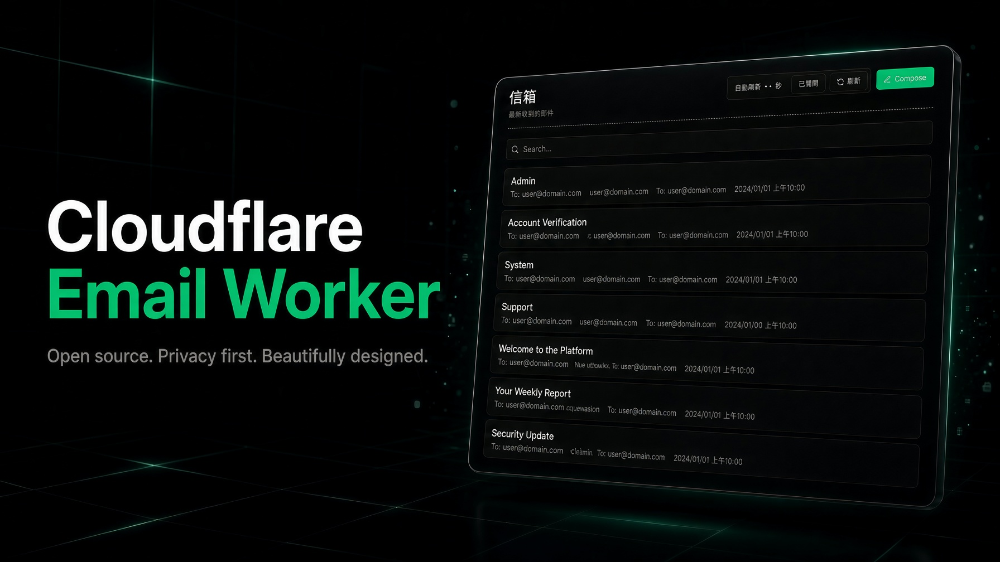

# Cloudflare Email Worker

[English](../README.md)



以 Cloudflare Email Routing 收信，Workers 提供 Webmail。D1 儲存郵件資料，R2 儲存附件與較大的原始郵件。

## 歡迎試用

打開 [https://demo.emailwk.itdog.ai](https://demo.emailwk.itdog.ai)。
這個 host 列出 `demo@emailwk.itdog.ai` 的郵件。（沒有 catch-all）

## 功能

- 收件匣分頁、搜尋主旨／寄件者／收件者，以及自動重新整理。
- HTML／純文字內容、外部與 CID 內嵌圖片、Raw 原文、完整標頭與附件下載。
- 管理網域可寄送純文字郵件、CC／BCC 與附件。成功寄件備份至 `sent`，失敗寫入收件匣通知。
- 支援含 One-Click 退訂標頭的郵件。
- 可選擇在管理 host 啟用會員登入，獨立分配收件／發件域名，支援初始化密碼、會員管理及寄件備份瀏覽。

## 初次設定

需 Node.js 22.18 或以上，並在該 Cloudflare zone 啟用 Email Routing。

由 Worker 寄信需要 Workers Paid 方案。之後在 Cloudflare 後台設定發信網域，Worker 才能直接寄出。

```bash
git clone https://github.com/siumx/cf-email-worker.git
cp package.json.example package.json
cp wrangler.toml.example wrangler.toml
npx wrangler login
npm run init
npm run deploy
```

- `wrangler.toml`：填入網站 hostname。執行 `npm run init` 前，確認此 Cloudflare 帳戶還沒有名為 `email-worker-db` 的 D1，以及名為 `email-worker` 的 R2。
- `ADMIN_MAIL_HOSTS`：可查看全部收件匣並寄信的完整 hostname。其他 host 去掉第一段，只顯示剩餘收件網域的郵件。`mail.example.com` 因此對應 `*@example.com`。
- `SENDABLE_DOMAINS`：此 Worker 允許使用的寄件者網域。未設定或空陣列時無法寄信。
- `RECEIVABLE_DOMAINS`：可分配給會員的收件域名，不限制 Email Routing 入庫，也不改變其他 host 的 catch-all 顯示。

部署後，在 Cloudflare Email Routing 將收件地址或 Catch-all 指到此 Worker。步驟見 [Cloudflare Email Routing Setup](Cloudflare_Email_Routing_Setup.md)。

## 啟用會員系統

會員模式**只套用於 `ADMIN_MAIL_HOSTS`**。其他 route hostname 維持目前的 catch-all 收件與禁止發件行為。

會員模式專用schema：src/SQL/member.sql


在設定檔啟用會員模式，並分別指定收件與發件域名：

```toml
[vars]
ADMIN_MAIL_HOSTS = ["mailadmin.example.com"]
MEMBER = { enable = true, admin = "admin", password = "admin"} # <--初始化使用的admin, 後續建議關閉
RECEIVABLE_DOMAINS = ["example.com", "abc.com"]
SENDABLE_DOMAINS = ["example.com", "notify.example.com"]
```

完成後用原本的部署指令發布。未設定 `MEMBER` 或 `enable = false` 時，維持原模式。沒有 `admin` 不影響會員模式。已啟用但 Secret 缺失或格式錯誤時會回報設定錯誤，不會放行匿名管理權限。

MEMBER的admin 不寫入會員表，可查看全部已儲存郵件，使用全部發件域名，以及建立、禁用、刪除會員、分配域名和重設密碼。首次登入後建立第一位會員。會員帳號亦是固定的郵箱前綴，不分大小寫；例如 `user` 獲配 `example.com` 與 `abc.com` 收件權限，就只能讀取 `user@example.com` 和 `user@abc.com`。發件域名獨立分配，全域域名移除後會在下一次請求生效。

新會員與被重設密碼的會員，須先修改初始化密碼才能使用郵箱。密碼以 scrypt（`N=16384, r=8, p=5`）加隨機 salt，再以 Worker Secret 中的 pepper 做 HMAC-SHA256。登入使用一小時的 HS256 JWT，放在 host-only、Secure、HttpOnly、SameSite Cookie，伺服器不保存登入狀態。

## 目錄

- `src/`：Worker。`index.ts` 路由請求，`handlers.ts` 處理郵件，`db.ts` 存取 D1。`npm run init` 先套用 `src/SQL/schema.sql`，再套用 `src/SQL/` 裡其餘 SQL。
- `public/`：Webmail 介面，以 Worker Assets 提供。
- `migrations/`：既有 D1 資料庫升級；`scripts/member-admin.mjs` 初始化或更新管理員 Secret。
- `wrangler.toml.example`：設定範本。複製成 `wrangler.toml`。

## API

路由在 `src/index.ts`。呼叫端須處理 `400`、`401`、`403`、`404`、`405`、`409`、`503`。會員 API 只在已啟用的管理 host 提供；寫入操作須帶相同來源的 `Origin` 與 `X-Requested-With: cf-email-worker`，瀏覽器使用同源 Cookie。私人 API 回應不快取。

| 方法 | 路徑 | 用途 |
| --- | --- | --- |
| `GET` | `/api/config` | Host 模式、登入狀態、身分與發件域名，可匿名讀取 |
| `GET` | `/api/mails?page=&q=&folder=inbox` | 依權限顯示列表；會員模式另支援 `folder=sent` |
| `GET` | `/api/mails/:id` | 單封郵件 |
| `GET` | `/api/mails/:id/attachments/:attachmentId` | 下載附件 |
| `POST` | `/api/mails/:id/unsubscribe` | One-Click 退訂 |
| `POST` | `/api/send` | 寄信。僅管理 host |
| `POST` | `/api/auth/login` | `{prefix, password}`，回傳身分並設定登入 Cookie |
| `POST` | `/api/auth/logout` | 清除登入 Cookie；token 在到期前仍然有效 |
| `GET` | `/api/auth/me` | 目前身分與首次改密旗標 |
| `POST` | `/api/auth/password` | 會員自己的 `{currentPassword, password}`，拒絕舊 token 並簽發新登入 |
| `GET` | `/api/members?page=&q=` | admin：會員分頁、數量與可用域名 |
| `POST` | `/api/members` | admin：`{prefix, password?, receiveDomains, sendDomains}`，回傳 ID 與一次性初始化密碼 |
| `PATCH` | `/api/members/:id` | admin：`{status?}` 與／或兩組域名陣列；前綴不可改 |
| `DELETE` | `/api/members/:id` | admin：撤銷權限並保留前綴 |
| `POST` | `/api/members/:id/password` | admin：`{password?}`，回傳一次性初始化密碼並拒絕原有 token |

## 限制

- 會員隔離只在已啟用的管理 host 生效，其他 host 維持既有 catch-all 存取；不應公開讀取的 host 請另以 Cloudflare Access 保護。
- 郵件 HTML 在隔離的 iframe 中顯示。排版與圖片保留，腳本與事件處理移除。外部圖片會直接載入，寄件方可以得知信件已被打開。
